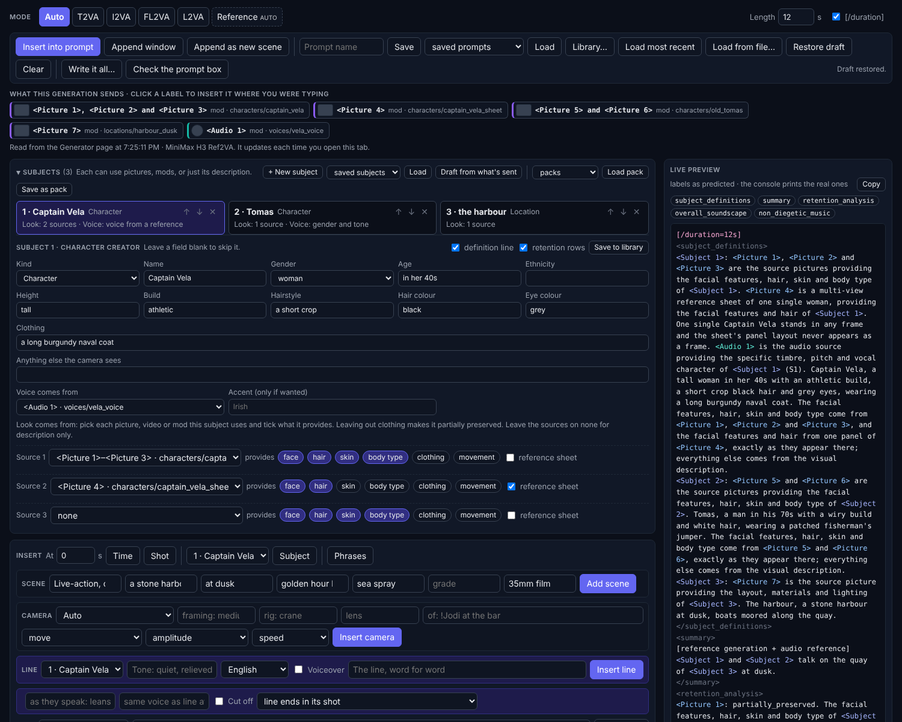
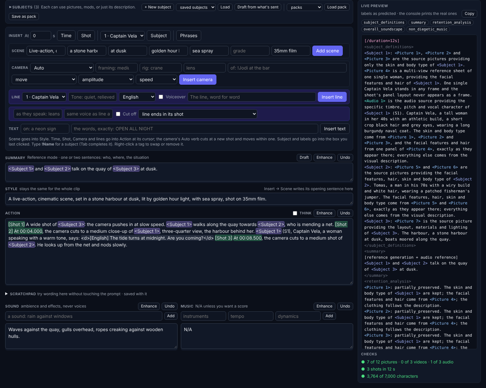
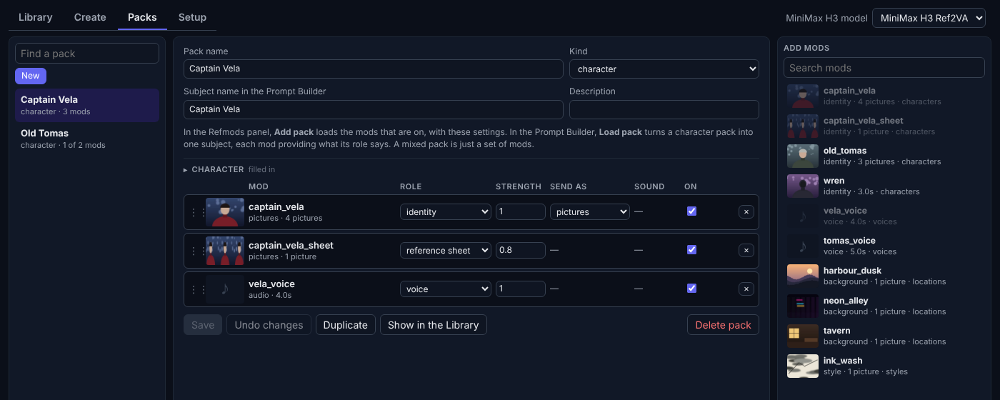
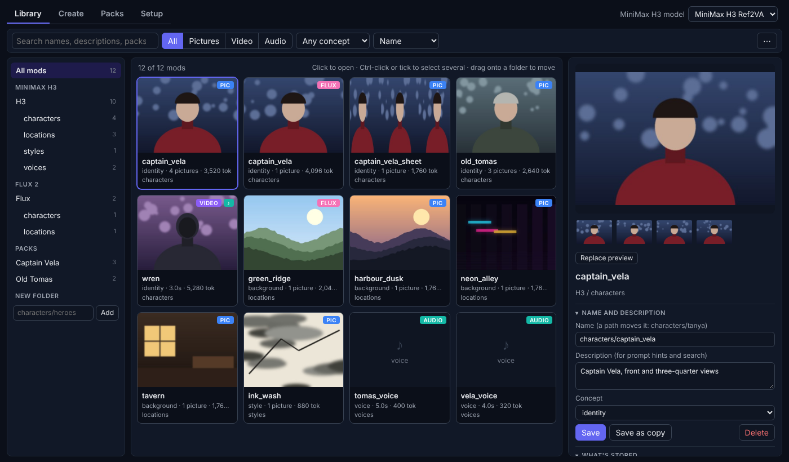
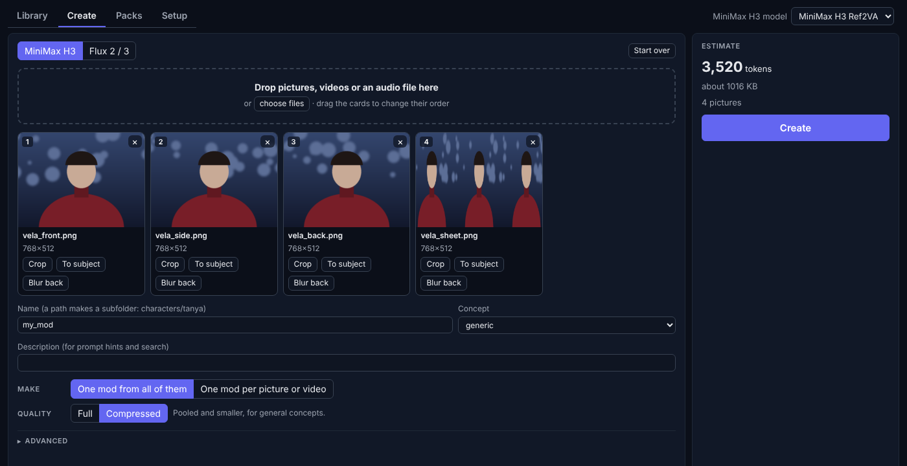

# Refmods Studio

Refmods and the MiniMax H3 Prompt Builder in one WanGP plugin, on one **Refmods Studio** tab with a subtab for each.
The button at the right of each page's header opens it full screen; Esc goes back.

- **Refmods**: no-training reference mods for MiniMax H3 (Ref2VA, FL2VA, FL2VA ControlNet, H3-Image, P-H3-Image)
  and Flux 2 / Flux 3. Compress a reference into a small `.safetensors` file once, then reuse it at any strength
  without re-encoding it every generation.
- **Prompt Builder**: builds MiniMax H3 prompts (T2VA, I2VA, FL2VA, L2VA, Ref2VA) from a form, inline under the
  prompt box and on its own subtab, with an optional panel that writes the prompt with WanGP's prompt enhancer and
  Deepy tools for H3 prompts.

The Refmods half started as Refmods For Wan GP `0.38.1-fork.58`; its guide, for how mods work, is in [`docs/refmods.md`](docs/refmods.md).
The Prompt Builder replaces the MiniMax H3 Prompt Builder 4.x. That plugin's guide is kept in
[`docs/prompt-builder.md`](docs/prompt-builder.md) for the parts that still apply: the enhancer and the Deepy tools.

The screenshots use made-up mods and placeholder pictures.

## The Prompt Builder

Load your references on the Generator page as usual (start and end images, reference images, videos, audio) and arm
any mods in the Refmods panel. The **Prompt Builder** subtab reads them:

- **Mode** is picked from what's loaded, and the buttons override it. **Subject sections** writes a base mode
  (FL2VA with RefMods, say) in the reference layout.
- **What this generation sends** lists every label the pipeline will give, in its order. Click one to insert it
  where you were typing. Dashed means it's sent but not used in the prompt yet.
- **Subjects**: name and describe each one with the character creator, then say where its look comes from (a
  picture, a mod, or the description only) and its voice (an audio reference, a voice mod, or gender and tone). In
  Reference mode they write `subject_definitions` and `retention_analysis` in the bundled H3 guide's wording.
- **Insert**: Shot, Camera, Subject and Dialogue write the guide's notation at the cursor. The camera row composes the
  shot (framing, rig, lens, what's in frame) and the move; on Auto it cuts at a new shot and moves within one. Only **Time** writes a
  timestamp, so a line or a shot has one only where you put it.
- **Tags**: right-click one to swap it with another or remove it, here, in this box or everywhere (a subject goes
  with its tag). Type `!Name` for a subject; Tab completes it.
- **Line** extras: what they do as they speak, same voice as an earlier line, **Cut off** (`<cutoff>`) and a line
  that carries across the cut (`<scenetrans>`, with the next Shot writing the receiving half). **Text** writes
  readable on-screen text.
- **Scene** (in Insert, above Camera) writes one opening sentence into Style from the style, place, time, light,
  atmosphere, grade and camera or film. **Sound** and **Music** presets compose ambience, and instruments, tempo
  and dynamics. Every box can be typed in.
- **Draft** on Summary writes who, where and when, with the situation as far as the action shows it.
- **Subjects** folds away when it gets long: click its title.
- Tags are **coloured** in every box. The **Scratchpad** under Action is for trying wording; Commit puts it in Action.
- **Phrases** keeps wording you reuse: select text and press Ctrl+Enter to save it.
- **Switches** above the preview leave a section out without deleting it; the subject editor does the same for a
  subject's definition line and retention rows.
- **Enhance** on Action, Sound and Music asks the prompt enhancer set in Configuration to write that box.
- The **live preview** shows the finished prompt, with the checks under it (including the window length).
  **Insert into prompt** and **Append window** put it in the prompt box.
- **Library…** lists your saved prompts with search, stars and categories, and arms the packs a prompt used.
  **Load most recent** and **Load from file…** are beside it.

The builder reads the Generator page each time you open the Refmods Studio tab, so load your references and arm your mods first.
**Check the prompt box** checks whatever is in the Generator page's prompt box.

## Packs

A pack is a set of mods, each with a role: identity, clothing, reference sheet, pose and motion, background, style
or voice. Packs can mix anything. In the **Refmods: MiniMax H3** panel, pick a pack and **Add pack** to put its mods
into the rows, or **Replace all** to start from it. Mods switched off in the pack are left out unless **Include
switched-off mods** is ticked. Type a name and **Save as pack** to keep the rows. In the Prompt
Builder, **Draft from what's sent** turns a character pack into one subject, each mod providing what its role says. Your old
presets are listed as packs.

A pack can also hold a character: the fields of the Prompt Builder's character creator. In the Prompt Builder, pick a
pack and **Load pack**: the Refmods panel arms its mods (with their strengths and labels) and the builder fills in the
subject, with each mod as a look source or the voice. **Save as pack** does the reverse: it saves the selected
subject's character, its mods and what each provides. The **Packs** page can edit the character too.

## The Refmods subtab

The Refmods subtab is one app with four pages. The **MiniMax H3 model** at the top is the one every job runs on:
creating, decoding, strength previews, encoder frames and soundtracks.

- **Library** holds every H3 and Flux mod. Pick a folder or pack on the left, search and filter at the top, and click
  a mod to see what's stored in it.
  - Rename or move it, edit its description and concept, or save a copy.
  - **Edit pictures** drops or reorders a picture mod's pictures. **Trim** a voice or soundtrack (scrub through it to set the in and out points), or remove one.
    Neither re-encodes anything, so they're instant.
  - What needs the model runs as a short task: **Decompile**, **Strength preview** (the first picture at a few
    strengths), **Decode to listen**, encoder frames (store them, or refresh a video mod's to cover the whole
    clip), soundtracks, **Clean audio** and **Convert to Flux**.
  - **Replace preview** sets the picture shown for a mod. The mod itself doesn't change.
  - Flux mods store a small preview of each source picture. Older ones show a rough preview worked out from the
    mod itself until you replace it.
  - Ctrl-click or tick several to move, add to a pack, update or delete them together, or drag them onto a folder.

  

- **Create** makes mods for MiniMax H3 or Flux. Drop pictures, videos or an audio file, drag them into order, crop
  pictures and videos (with rotate and mirror), crop a picture to its subject or blur its background, and scrub through videos and audio to set in and out points; **Use frame** and **Use audio** add a still or the kept sound as a new source. Make one mod from all of them or one per picture or video, at **Full** (exact, best
  for faces) or **Compressed** (smaller). The estimate shows the tokens and file size, and **Create** stays locked
  until the mod can be made. Every option from the old Extract tabs is under **Advanced**.

  

- **Packs** edits packs: their mods, each one's role, strength (up to 2), how it's sent, its sound, and an **On**
  switch that keeps a mod in the pack but leaves it out when the pack is added.
- **Setup** checks that Refmods is hooked into the chosen model, shows the mods Showrunner, Deepy and API tasks
  get, and says where everything is kept.

## Installing

1. In WanGP's **Plugin Manager**, install from `https://github.com/jedsdead/Refmods-Studio-For-WanGP`, or download
   the release and put its folder in WanGP's `plugins` folder.
2. In **Plugin Manager**, disable **Refmods For Wan GP** and **MiniMax H3 Prompt Builder** if you have them, and
   enable **Refmods Studio**.
3. Restart WanGP.

Refmods Studio won't load while either old plugin is enabled, because the same pipeline hooks would be installed
twice. It says so in the console and on its tab.

## Your data

Nothing needs moving:

- Mods and presets stay in `loras/refmods_plugin/`, as with Refmods For Wan GP. Packs are in its `packs/` folder,
  custom previews in `previews/`, and files added on the Create page in `uploads/`.
- Drafts, saved prompts and saved subjects stay in `loras/h3_prompt_builder/`, as with the Prompt Builder 4.4.0.
  If you're coming from 4.3 or earlier, they're copied in from the old plugin folder the first time Refmods Studio
  starts.
- Refmods Studio's own settings are in `loras/refmods_studio/settings.json`.

## Settings

**Settings** is the last subtab, beside Refmods and Prompt Builder, and it's there whichever part is on. Untick
**Refmods** or **Prompt Builder** to hide that part completely, then restart WanGP. A part that's off isn't loaded at
all (turning off Refmods also removes its pipeline hooks), and the other keeps working. Without Refmods, the Prompt
Builder hides its pack buttons, since packs and armed mods come from Refmods.

**Page size** on the same subtab makes the three pages smaller or larger (80% to 130%) without zooming the rest of
WanGP. It applies straight away, and the browser remembers it.

## Credits

- **Luisa** ([ComfyUI-MiniMaxH3Mod](https://github.com/Luisacaotica/ComfyUI-MiniMaxH3Mod)): the RefMod idea and
  file format. `refmods/core.py` is a close port of its `core.py` (MIT License, (c) 2026 Luisa/luisacaotica).
- **g3n3rativ3** ([MiniMaxH3Mod-for-WanGP](https://github.com/g3n3rativ3/MiniMaxH3Mod-for-WanGP)): the Wan2GP port
  the Refmods half is built on. See [`docs/refmods.md`](docs/refmods.md) for what came from its later releases.
- **Adudeguyman** ([ComfyUI-Fantastic-MiniMaxH3-PromptBuilder](https://github.com/Adudeguyman/ComfyUI-Fantastic-MiniMaxH3-PromptBuilder)):
  the ideas for coloured tag chips, the prompt library and the scratchpad, built here in this plugin's own way.
- **ComfyUI** ([comfyanonymous/ComfyUI](https://github.com/comfyanonymous/ComfyUI)): the Flux 2 latent-to-RGB factors
  used for the rough previews of older Flux mods.
- **malcolmrey** ([ComfyUI-Flux2Klein9Mod](https://github.com/malcolmamal/ComfyUI-Flux2Klein9Mod)): the Flux 2 /
  Klein RefMod file layout used by the Flux mods.

## License

MIT for the code written for this plugin; see [`LICENSE`](LICENSE). The Refmods half keeps its own terms and
attribution in [`refmods/LICENSE`](refmods/LICENSE), and the Prompt Builder half its MIT licence in
[`builder/LICENSE`](builder/LICENSE).
